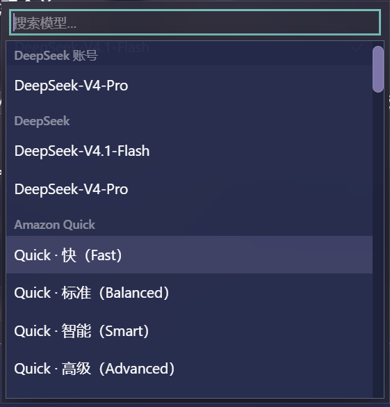

# dsh-quick-connect

把 **Amazon Quick**（AWS 的 AI 助手桌面客户端）的聊天时长接进 DeepSeek Harness（DSH）——在 DSH 里选 Quick 的档位模型聊天，消耗 Quick 账号的免费/订阅时长，而不是 token。

- 版本：0.2.1
- 仓库：https://github.com/weilifox/dsh-quick-connect
- 前置：本机装过 Amazon Quick 桌面端（默认在 `%LOCALAPPDATA%\Programs\quickwork`）并登录过一次；凭据留在 Windows 凭据管理器里，本插件**只读**



## 档位（= 三/四档消耗规则）

| 模型 id | Quick `agent_mode` | 定位 | 实测路由 |
|---|---|---|---|
| `fast` | fast | 最省时长，日常问答 | `us.anthropic.claude-haiku-5-5` |
| `balanced` | balanced | 均衡 | 待实测 |
| `smart` | smart | 默认推荐 | 待实测 |
| `advanced` | advanced | 最强，烧时长最快 | 待实测 |

档位随每条消息发送，云端按档自动路由底层模型；DSH 侧选哪个 id 就发哪个 `agent_mode`。

## 本机工具（v0.2.0 新增，v0.2.1 稳定）

Quick 的云端 agent 除了 Amazon 侧工具，还能调用**本机工具**——这就是 Quick 桌面端「Outpost」通道。插件现在把它接上了：

1. 插件按需拉起 Quick 自带的 `quickwork-agent.exe --outpost-only`（同一个二进制，独立端口，不启动 Quick 界面）；
2. 用一次性的 instance token（`crypto.randomBytes(32)`，只经 stdin 下发、不落盘）调它的本地 HTTP API；
3. 聊天时在 `user_message` 里带上 `outpostId` 等设备字段，云端就把这一轮认作「来自用户设备」，工具调用通过 WSS 以 `tool_call` 帧下发，插件转给本机 outpost 执行，再用 `tool_result` 帧回传。

实测可用：本机 Python（`run_python_outpost_local` / `_with_write`）、文件读（云端发 `file_upload`，outpost 自己传到 S3 后云端再读）、文件写（云端发 `file_download` 下发 staged 产物）、`ripgrep`/`fdfind`/`folder_list` 等 47 个工具。

**文件访问白名单**：Quick 的 outpost 只允许访问登记过的目录（`/local/allowed_folders`）。插件启动后按设置项 `allowedFolders`（换行或 `;` 分隔）逐个登记；留空则默认登记 DSH 宿主的工作目录。未登记的路径会返回 `Access denied. Path is not in allowed folders: []`。

**安全边界**：本机工具由 Quick 自己的 outpost 执行、走它自己的策略（`human_pps_grant` 审批来源），插件不额外放大权限；关掉开关（设置项 `localTools = false`）即完全不拉 outpost，行为回到 0.1.1 的纯聊天。

## 用量显示

设置 → 插件 → Amazon Quick 卡片展开后显示：

- 本次会话用量（分钟 / 上限，进度条）
- 本月用量（分钟 / 上限，进度条）
- 订阅状态（如 `QUICK_LITE_FREE_TRIAL（免费试用，2026-12-21 到期）`）

数据来自 Quick 自己的 `/profile/usage`，只读。

## 工作原理（三条通路，全部实测）

1. **凭据**：Windows 凭据管理器 `quickwork-social-<profileId>`（+`_chunk_N`）→ CredRead 读出 `refresh_token/client_id/client_secret`；profile 元数据来自 `~/.quickwork/profiles.json`。**全程只读，不写回**。
2. **续票**：`POST https://oidc.us-east-1.amazonaws.com/token`（grantType `refresh_token`）换 1h accessToken。标准 AWS SSO OIDC API，无需启动 Quick 客户端。换出的新 refresh_token 只存内存。
3. **聊天**：`wss://{tenant}/streaming/quickwork-chat-bidirectional-stream?surfaceType=QUICK_WORK_DESKTOP_WINDOWS&token=…&workingSessionId=…`
   - 出站帧：binary JSON `{eventType:"rawInputEvent",payload:{payload:base64(内部JSON)}}`
   - 入站帧：AWS event-stream 头 + JSON `{"payload":base64(内部JSON)}`（尾部带 CRC，需容忍尾随字节）
   - 直接发 `user_message`（URL 的 workingSessionId 即会话，`session_connect` 会被拒 unknown_message_type）
   - 收 `text_delta…text_complete/message_complete` 组装答案，`turn_usage` 回填 token 用量，`resolved_model_id` 记录实际路由模型

**代理**：tenant 域名（`*.dp.appintegrations.*.plato.ai.aws.dev`）不在公共 DNS。插件启动时探测本机代理（`127.0.0.1:7897/7890/10809/8888`，可用 `QUICK_CONNECT_PROXY` 环境变量或设置里的代理项指定），走 HTTP CONNECT 隧道发 HTTPS/WSS。

## 安装

前提：DSH 桌面版（profile 目录 `~/.dsh/profiles/desktop`，下称 `<profile>`），并把本仓库克隆到任意位置（下称 `<插件目录>`）。

1. 登记成 profile 依赖（推荐 link，便于改代码即生效）：
   ```bash
   cd ~/.dsh/profiles/desktop
   pnpm add "link:<插件目录>" --config.minimum-release-age=0
   ```
2. 让 DSH 加载这个 bundle：在 `<profile>/package.json` 的 `dsh.profile.bundles` 数组里追加 `"dsh-quick-connect"`。
3. 插件目录里的 `node_modules` 需要能解析宿主依赖（`@deepseek-ai/*`、`@earendil-works/pi-ai`）。用 pnpm 装依赖，或直接指向 DSH 自带的 `node_modules`：
   ```bash
   cd <插件目录>
   ln -s "<DSH安装目录>/resources/app/dsh/node_modules" node_modules   # Windows 用 mklink /J 或 New-Item -ItemType Junction
   ```
4. 重启 DSH，在「设置 → 插件 → Amazon Quick」里应当看到登录态与用量条。

卸载：从 `package.json` 的 `dependencies` 和 `dsh.profile.bundles` 里删掉本插件，重装依赖，重启 DSH。

## 状态路由

```bash
curl http://127.0.0.1:<DSH端口>/plugins/dsh-quick-connect/status   # 状态+用量
curl -X POST http://127.0.0.1:<DSH端口>/plugins/dsh-quick-connect/action \
  -H 'content-type: application/json' -d '{"action":"refresh"}'    # 强制刷新
```

## 自检

```bash
cd dsh-quick-connect && node scripts/selfcheck.mjs    # 离线自检
node scripts/verify-live.mjs                          # 真网链路（会真发一条 pong）
node scripts/verify-live.mjs --mode=balanced          # 指定档位实测路由模型
node scripts/verify-localtools.mjs                    # 本机工具（拉 outpost + 两轮真调用）
QUICK_DEBUG_EVENTS=1 node scripts/verify-localtools.mjs   # 打协议帧，排障用
```

## 已知限制

- **宿主 system prompt 被塌缩**：DSH 的 project_instructions（含 25 条 Scoped Rules）会触发 Quick 的内容审核（USER_QUERY/BUILT_IN），逐轮必拦。插件现在对 Quick 通路**不发送宿主原版 system prompt**，只发一条中性任务前言 + 你的消息 + 会话历史。Quick 反正不认外来 persona，不影响回答质量。
- **本地工具只经 Quick 的 outpost**：文件/Python 都在 `quickwork-agent.exe` 里执行，受它的目录白名单约束；DSH 自己的工具（ops_bash 等）不会被 Quick 调用，两套工具面是分开的。
- 不带图片输入（Quick 桌面端协议的图片通路未逆向）。
- Quick 客户端退出登录 / 换号后，插件凭据会失效——重新在 Quick 登录一次即可，无需动插件。
- 协议是私有的，Amazon 改协议/风控会导致失效；`turn_usage.resolved_model_id` 可用于判断档位是否被服务端调整。

## 排障

| 现象 | 原因 → 处理 |
|---|---|
| 设置卡「未登录」 | Quick 没登录过 / profiles.json 缺失 → 打开 Quick 登录一次 |
| OIDC refresh failed 400/403 | refresh_token 被 Quick 侧轮换 → 状态卡点「刷新用量」重读凭据 |
| `fetch failed` / handshake 失败 | 本机代理没开 → 启动 Clash 类代理，或设置里指定代理 |
| `Unsupported surface type` | 协议常量变了 → 重新逆向 surfaceType |
| 能聊但答案怪 | 检查 `turn_usage.resolved_model_id` 是否符合预期档位 |
| 答到一半突然断流 | 客户端每 25s 要发 `ping` 保活（已实现）；本机工具耗时过长时服务端会先关流，重试即可 |
| 设备工具报 `Path is not in allowed folders` | 目标路径不在 `allowedFolders` → 设置里加一行该目录 |
| `本机工具通道未启用` | 设置项 `localTools` 被关，或 outpost 起不来 → 看状态卡 `localTools.error` / 手动 `outpost-restart` |
